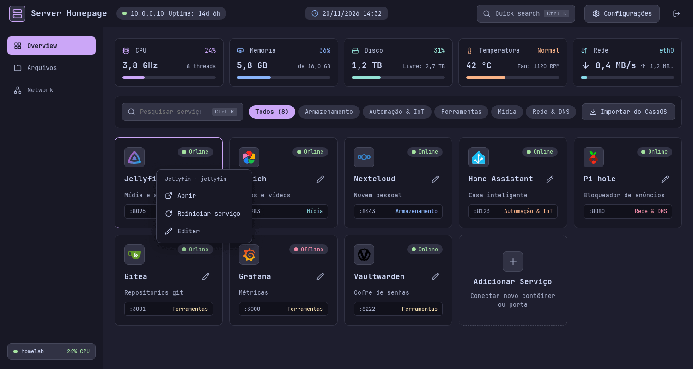
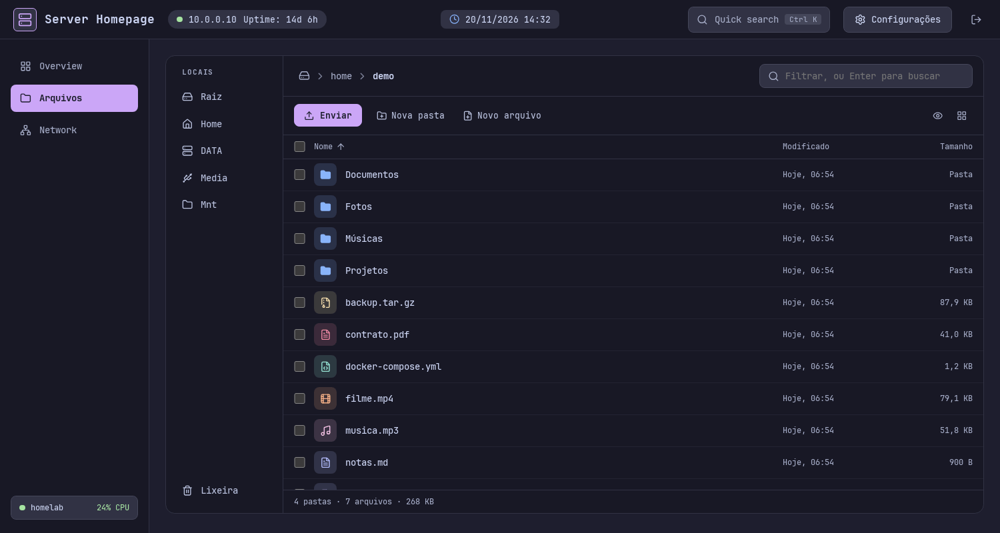
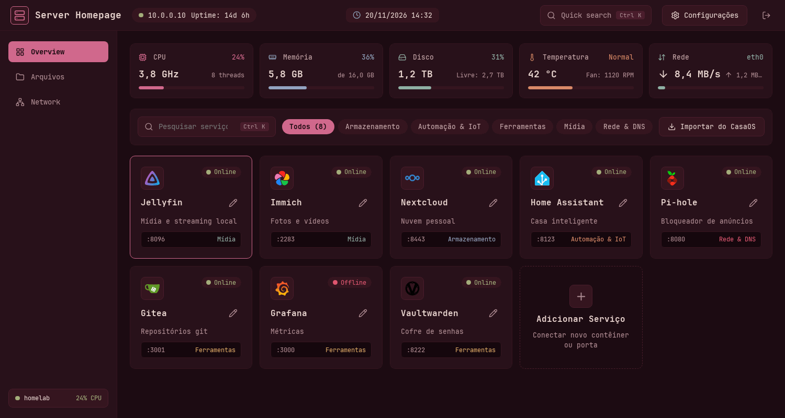

<p align="center">
  
</p>

# Homepage

Painel leve para o seu homelab: estado da máquina, atalhos para os serviços, controle dos
contêineres e um gerenciador de arquivos rápido. Uma imagem de **menos de 3 MB** para baixar,
com o back-end em Rust e o front em React.



## O que faz

| | |
|---|---|
| **Monitor** | CPU, memória, disco, temperatura, fan e rede em tempo real |
| **Serviços** | cadastro manual ou importado do CasaOS, com busca, filtros e status |
| **Contêineres** | inicia, reinicia e atualiza com o botão direito, mostrando o erro e o log se falhar |
| **Arquivos** | enviar, baixar, copiar, mover, lixeira, busca, miniaturas e edição de texto |
| **App** | instalável em navegadores Chromium, com layout para celular e tablet |
| **Temas** | Catppuccin, Gruvbox e Vinho, claros e escuros |



## Como usar

```yaml
services:
  homepage:
    image: softfrost/homepage-rust:latest
    container_name: homepage
    network_mode: host
    user: "0:0"
    restart: unless-stopped
    read_only: true
    cap_drop: [ALL]
    cap_add: [CHOWN, DAC_OVERRIDE, FOWNER, FSETID]
    security_opt: ["no-new-privileges:true"]
    environment:
      LISTEN: "5173"
      FILES_ROOT: /host
      DISK_PATH: /host
    volumes:
      - /:/host:rslave
      - /etc/localtime:/etc/localtime:ro
      - ./data:/data
```

```sh
docker compose up -d
```

Abra `http://<servidor>:5173` e **crie a conta logo em seguida**: até lá, quem abrir a página
primeiro pode criá-la.

## Configuração

| Variável | Padrão | Para quê |
|---|---|---|
| `LISTEN` | `5173` | porta ou `ip:porta` |
| `FILES_ROOT` | `/` | onde a máquina está montada |
| `DISK_PATH` | `/` | caminho no disco a medir |
| `READ_ONLY_PATHS` | `/DATA/AppData` | pastas protegidas, separadas por `:` |
| `DOCKER_SOCKET` | `<FILES_ROOT>/run/docker.sock` | socket do Docker |
| `CPU_FAN_PATH` | | arquivo `fanN_input` da fan da CPU |
| `DATA_DIR` | `/data` | conta, serviços e lixeira |

## Segurança

Com a configuração acima, **quem entra controla a máquina**: lê e altera os arquivos e usa o
Docker. Use uma senha forte e não exponha na internet. Prefira o Tailscale, que também fornece
o HTTPS exigido para instalar como app.

## Tags

- `latest`: última versão da `main` que passou nos testes
- `sha-<commit>`: uma versão específica

Só `linux/amd64`. Código e documentação:
[github.com/rillmind/homepage-rust](https://github.com/rillmind/homepage-rust)


