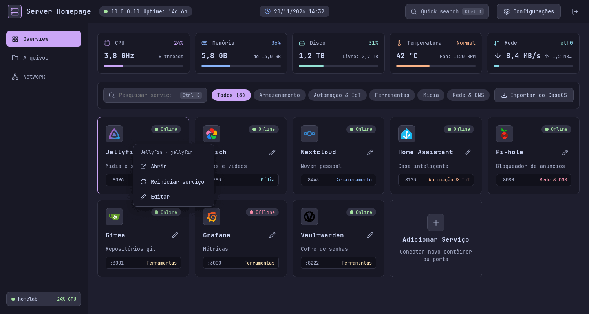

<div align="center">

# homepage-rust


Página inicial para o meu servidor caseiro: uma tela só com o estado da máquina,
atalhos e informações do dia a dia, acessível de qualquer dispositivo da rede.

[](https://www.rust-lang.org)
[](https://react.dev)
[](https://www.typescriptlang.org)
[](https://vite.dev)
[](https://bun.sh)
[](https://catppuccin.com)

</div>



## A ideia

Quem tem um servidor em casa acaba com uma dúzia de abas abertas: um painel para ver
uso de memória, outro para ver se o serviço X está de pé, o IP anotado em algum canto.
O objetivo deste projeto é juntar isso numa homepage simples, que eu possa deixar
como página inicial do navegador.

O back-end roda no próprio servidor e lê as informações direto do sistema. O front
consulta essas informações a cada segundo e mostra tudo numa barra no topo e em
blocos na página.

Não é um produto pronto nem pretende competir com Homarr, Dashy e afins. É um projeto
pessoal, feito do jeito que eu quero usar e também para estudar Rust e React. É a continuação do
[homepage](https://github.com/rillmind/homepage), com o back-end reescrito de Go para Rust.

## O que já funciona

- Login com usuário único, criado no primeiro acesso
- CPU, memória, disco, temperatura, fan e rede em tempo real
- Serviços cadastrados à mão ou importados do CasaOS, com busca, filtros e status da porta
- Iniciar e reiniciar o contêiner do serviço com o botão direito, com o erro e o log se falhar
- Gerenciador de arquivos: enviar, baixar, copiar, mover, renomear, lixeira, busca,
  miniaturas, visualização e edição de texto
- Página Network com todas as interfaces
- Temas Catppuccin, Gruvbox e [Vinho](https://github.com/rillmind/obsidian-vinho)
- Layout para celular, tablet e computador
- Configurações: título, tema, intervalo de atualização e senha

## Como funciona

```
┌──────────────┐   fetch a cada 1s   ┌───────────────────┐  /proc, /sys  ┌─────────┐
│  front-end   │ ──────────────────► │  back-end (Rust)  │ ────────────► │  Linux  │
│  React/Vite  │ ◄────────────────── │  axum, :2306      │               └─────────┘
└──────────────┘        JSON         └───────────────────┘
```

Em produção é uma imagem só, de uns 5 MB: o binário serve a API em `/homepage-api` e os
arquivos do front. Em desenvolvimento, o Vite repassa `/homepage-api` para o back.

### Segurança

Quem entra tem acesso aos arquivos da máquina inteira, com as permissões do usuário do
container. **No docker, o padrão é root.**

- Crie a conta logo depois de subir: até lá, quem abrir a página primeiro pode criá-la.
- O servidor não faz HTTPS: use o `tailscale serve` (abaixo) e não exponha a porta na internet.
- Esqueceu a senha? Apague `data/auth.json` e reinicie o back para cadastrar de novo.
- São somente leitura: `/proc`, `/sys`, `/dev`, `/run` e `/DATA/AppData`. As pastas da raiz,
  como `/etc`, não podem ser movidas nem excluídas, mas o que está dentro delas pode.
- A lixeira é a pasta `.homepage-trash` de cada disco e não se esvazia sozinha.

### Endpoints

| Método     | Rota               | Para quê                                          |
| ---------- | ------------------ | ------------------------------------------------- |
| GET, POST  | `/auth/*`          | cadastro, login, saída e senha                    |
| GET        | `/stats`           | todos os dados da máquina; `null` é dado ausente  |
| GET, POST  | `/services`        | lista e cria serviços                             |
| PUT, DELETE| `/services/{id}`   | edita e exclui                                    |
| GET        | `/services/{id}/container` | contêiner do serviço e se está rodando    |
| POST       | `/services/{id}/start` ou `/restart` | inicia ou reinicia o contêiner  |
| GET        | `/services/status` | status das portas dos serviços, por id            |
| GET        | `/probe/{porta}`   | testa uma porta da máquina                        |
| GET        | `/casaos/apps`     | apps instalados pelo CasaOS                       |
| várias     | `/files/*`         | gerenciador de arquivos                           |

### Configuração

| Variável       | Onde  | Para quê                                                             |
| -------------- | ----- | -------------------------------------------------------------------- |
| `DOCKER_SOCKET` | back | socket do Docker; por padrão, `<FILES_ROOT>/run/docker.sock`         |
| `CPU_FAN_PATH` | back  | arquivo `fanN_input` da CPU, se as fans da placa não tiverem label   |
| `DISK_PATH`    | back  | caminho no disco a medir; por padrão, `/`                            |
| `DATA_DIR`     | back  | pasta dos dados; por padrão, `data`                                  |
| `FILES_ROOT`   | back  | onde a máquina está montada; por padrão, `/`                         |
| `READ_ONLY_PATHS` | back | pastas protegidas, separadas por `:`; por padrão, `/DATA/AppData` |
| `LISTEN`       | back  | porta ou `ip:porta`; na imagem, `5173`; fora dela, `127.0.0.1:2306`  |
| `FRONT_DIR`    | back  | arquivos do front para servir; sem ela, só a API                     |
| `APP_UID`      | compose | usuário do container; por padrão, `0`                                   |

## Rodando

Precisa de Linux, [Rust 1.88+](https://rustup.rs) e [Bun](https://bun.sh).

```sh
git clone https://github.com/rillmind/homepage-rust.git
cd homepage-rust

make install                # dependências do back e do front
make run                    # sobe back e front em segundo plano
```

O back fica em `http://localhost:2306` e o front no endereço que o Vite mostrar
(por padrão `http://localhost:5173`; o log fica em `front-end/dev.log`).

Para parar ou reiniciar:

```sh
make stop
make restart
```

Também dá para controlar cada parte separadamente com `make run-back`,
`make stop-front` etc.

### No servidor, com docker

Baixe o `docker-compose.yaml`, crie um `.env` e suba a imagem pronta do Docker Hub:

```sh
mkdir -p homepage/data && cd homepage
curl -O https://raw.githubusercontent.com/rillmind/homepage-rust/main/docker-compose.yaml
echo 'LISTEN=127.0.0.1:5173' > .env   # só o tailscale serve acessa
docker compose up -d
```

Para atualizar: `docker compose pull && docker compose up -d`.

### Como app (PWA)

Navegadores baseados em Chromium só instalam apps de páginas com HTTPS. O Tailscale fornece:

```sh
sudo tailscale serve --bg 5173
```

Abra o endereço `https://<máquina>.<tailnet>.ts.net` que ele mostrar e use "Instalar app".

### Com podman, compilando

```sh
podman-compose up --build -d   # http://localhost:5173
podman-compose down
```

Para atualizar, rode o `down` antes do `up --build -d`: com o container no ar, o
`podman-compose` gera a imagem nova, mas continua usando a antiga.

### CI

Todo push na `main` roda os testes e, se passarem, publica `softfrost/homepage-rust` no Docker
Hub. Precisa da variável `DOCKERHUB_USERNAME` e do secret `DOCKERHUB_TOKEN` no repositório. Com
o secret `DOCKERHUB_README_TOKEN`, também atualiza a página com `docs/DOCKERHUB.md`.

### Serviços

Ficam em `data/services.json`, fora do git. Para reutilizar em outra máquina, copie esse
arquivo e reinicie o back, que só o lê ao iniciar.

## Como testar

```sh
make test   # testes e clippy do back, build e lint do front
```

Para conferir o funcionamento, rode `make run`, consulte um endpoint com
`curl http://localhost:2306/homepage-api/auth/status` e abra o endereço do Vite.

## Estrutura

```
homepage-rust/
├── Makefile              orquestra back e front
├── Dockerfile            imagem única, com back e front
├── docker-compose.yaml   sobe com docker ou podman
├── .github/workflows/    testes e publicação da imagem
├── back-end/src/
│   ├── main.rs           servidor HTTP e desligamento
│   ├── auth/             conta, senha e sessões
│   ├── casaos.rs         leitura dos apps do CasaOS
│   ├── files/            gerenciador de arquivos
│   ├── pc_info/          dados da máquina
│   └── services/         cadastro e status dos serviços
└── front-end/src/
    ├── lib/              api, polling, formatação e preferências
    └── components/       Auth, Files, Nav, Sidebar, Monitor, Services, Network, Settings
```

## Próximos passos
- [ ] Baixar e enviar pastas
- [ ] Página de logs do servidor
